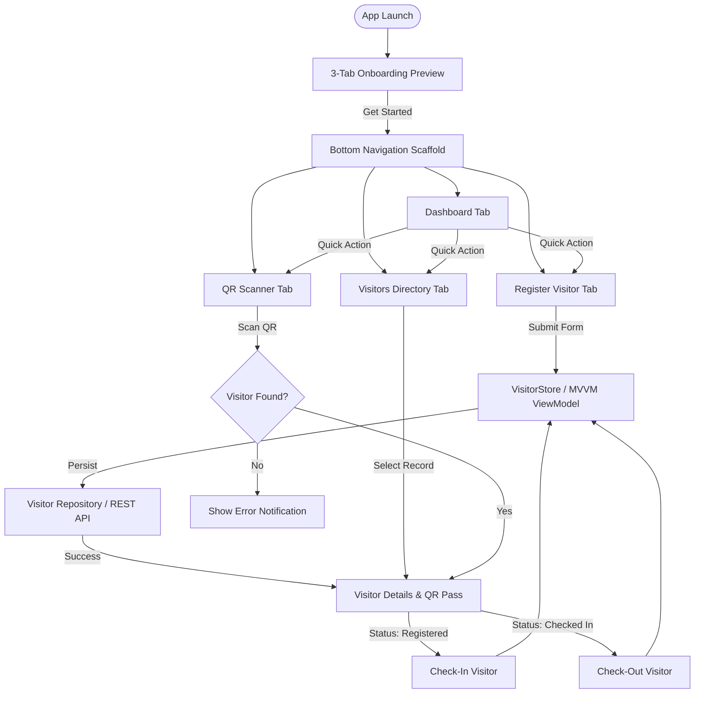

# Visitor Management Mobile Application

[](https://flutter.dev)
[](https://dart.dev)
[](https://flutter.dev/multi-platform)
[](https://en.wikipedia.org/wiki/Model%E2%80%93view%E2%80%93viewmodel)
[](https://pub.dev/packages/mobx)
[](https://pub.dev/packages/get_it)

A modern, responsive, and robust **Visitor Management Mobile Application** designed for real-estate residential properties and front-desk security personnel. Built with Flutter, following the **MVVM (Model-View-ViewModel)** architectural pattern with **MobX** reactive state management and **GetIt** dependency injection.

---

## 📋 Table of Contents

- [Project Overview](#-project-overview)
- [Key Features & Modules](#-key-features--modules)
  - [1. Modern Onboarding Preview](#1-modern-onboarding-preview)
  - [2. Dashboard & Live Analytics](#2-dashboard--live-analytics)
  - [3. Visitor Registration & Validation](#3-visitor-registration--validation)
  - [4. Visitor Listing & Real-time Search](#4-visitor-listing--real-time-search)
  - [5. QR Code Generation & Scanning](#5-qr-code-generation--scanning)
  - [6. Check-In / Check-Out Lifecycle](#6-check-in--check-out-lifecycle)
- [Application Flow & Navigation](#-application-flow--navigation)
- [Architecture (MVVM + MobX)](#-architecture-mvvm--mobx)
  - [Layer Separation](#layer-separation)
  - [Directory Structure](#directory-structure)
  - [State Management with MobX](#state-management-with-mobx)
  - [Dependency Injection with GetIt](#dependency-injection-with-getit)
- [Tech Stack & Dependencies](#-tech-stack--dependencies)
- [Mock REST API Specifications](#-mock-rest-api-specifications)
- [Setup & Execution Instructions](#-setup--execution-instructions)
  - [Prerequisites](#prerequisites)
  - [Step-by-Step Installation](#step-by-step-installation)
  - [MobX Code Generation](#mobx-code-generation)
  - [Running the Application](#running-the-application)
  - [Building Debug & Release APK](#building-debug--release-apk)
- [Permissions & Device Configuration](#-permissions--device-configuration)
- [Design System & Theme Tokens](#-design-system--theme-tokens)
- [Assignment Compliance Checklist](#-assignment-compliance-checklist)

---

## 🏢 Project Overview

In residential real estate developments, tracking customer property inspections, contractor visits, and vendor arrivals across multiple projects requires a fast, reliable front-desk mobile tool. This application modernizes the check-in process:

- **Eliminates paper logbooks** by digitizing visitor entries with instant timestamps.
- **Enforces data integrity** through strict phone, email, and visitor classification rules.
- **Generates unique QR badges** tied to visitor record IDs for rapid on-site verification.
- **Provides instant front-desk visibility** via live metrics (Total Today, Currently Checked In, Checked Out Today).
- **Employs MVVM architecture** to ensure complete separation of UI presentation, reactive business state, and data sources.

---

## ✨ Key Features & Modules

### 1. Modern Onboarding Preview
- Smooth 3-tab walkthrough carousel highlighting key system workflows:
  1. *Smart Visitor Management* (Quick digital registration & pass generation).
  2. *Instant QR Check-In / Out* (Contactless front-desk entry).
  3. *Real-time Analytics* (Live occupancy & visit tracking).
- Dynamic navigation indicators, animated page transitions, and persistent "Get Started" entry to the main interface.

### 2. Dashboard & Live Analytics
- **Today's Summary Cards**:
  - **Total Visitors Today**: Registered visitors for the current calendar date.
  - **Currently Checked In**: Active visitors on-site awaiting checkout.
  - **Checked Out Today**: Visitors whose visit is completed.
- **Quick Actions**: One-tap access to *Register Visitor*, *Visitor Directory*, and *QR Scanner*.
- **Dynamic Recalculation**: Analytics update automatically upon registration or status changes.

### 3. Visitor Registration & Validation
- **Input Fields**:
  - `Visitor Name`: Required text.
  - `Mobile Number`: Required numeric, validated to exactly 10 digits.
  - `Email`: Optional, validated against standard email format if provided.
  - `Visitor Type`: Dropdown (`Customer`, `Vendor`, `Other`).
  - `Project`: Dropdown selection (e.g., `Project A`, `Project B`, `Project C`).
  - `Purpose of Visit`: Required text (e.g., *Site Visit*, *Property Inspection*, *Maintenance*).
- **Initial Status**: New records default to `Registered`.
- **Instant Pass**: Auto-creates a unique visitor ID and prepares a digital pass.

### 4. Visitor Listing & Real-time Search
- **Visitor Directory**: Displays visitor name, mobile, project name, visitor badge, and status chips.
- **Live Search**: Instant client-side search by visitor name or mobile number with real-time filtering.
- **Action Menu**: View complete details, update visitor info, or delete records with confirmation dialogs.

### 5. QR Code Generation & Scanning
- **QR Code Generation (`qr_flutter`)**: Renders sharp, high-contrast QR codes encoding visitor IDs directly on the visitor pass/details screen.
- **QR Code Scanner**: Live camera-based scanner with viewfinder overlay to scan passes, match IDs against the repository, and open visitor actions.

### 6. Check-In / Check-Out Lifecycle
Strict adherence to the single-visit lifecycle:
$$\text{Registered} \longrightarrow \text{Checked In} \longrightarrow \text{Checked Out}$$

- **Rules**:
  - ❌ A visitor **cannot check out** before checking in.
  - ❌ A visitor **cannot check in twice** (duplicate check-in prevented).
  - ❌ Completed visits (`Checked Out`) are finalized.
  - 🕒 Timestamps (`check_in_time`, `check_out_time`) are captured in ISO 8601 format.

---

## 🗺️ Application Flow & Navigation



---

## 🏗️ Architecture (MVVM + MobX)

The project is structured according to the **Model-View-ViewModel (MVVM)** architectural pattern:

```
┌──────────────────┐         Observes State          ┌───────────────────────┐
│       VIEW       │ ◄───────────────────────────── │       VIEWMODEL       │
│  (Flutter UI)    │ ─────────────────────────────► │     (MobX Store)      │
└──────────────────┘          Triggers Actions       └───────────┬───────────┘
                                                                 │ Calls
                                                                 ▼
                                                     ┌───────────────────────┐
                                                     │         MODEL         │
                                                     │  Repository & Data    │
                                                     └───────────────────────┘
```

### Layer Separation
1. **Model**:
   - `VisitorModel`: Plain Dart data models with JSON serialization/deserialization.
   - `VisitorRepository`: Abstraction layer coordinating REST API data (`Dio` / `http`) and local caching (`shared_preferences`, `get_storage`).
2. **ViewModel (MobX Stores)**:
   - `VisitorStore`: Manages reactive observables (`visitors`, `isLoading`, `searchQuery`, `todayStats`), computed properties, and asynchronous actions (`fetchVisitors`, `registerVisitor`, `checkIn`, `checkOut`, `deleteVisitor`).
   - `ThemeStore` & `LanguageStore`: Manages light/dark theme state and localization.
3. **View (Screens & Widgets)**:
   - Declarative widgets wrapped in `Observer` from `flutter_mobx` to automatically rebuild only when observed state changes.
   - Zero direct business logic or direct API calls in widgets.

### Directory Structure

```text
lib/
├── constants/            # Theme tokens, colors, typography, strings, dimensions
│   ├── app_theme.dart    # Light (Warm White & Gold Cream) and Dark (Obsidian & Gold)
│   ├── colors.dart       # AppColor palette constants
│   ├── strings.dart      # Application text constants
│   └── assets.dart       # Asset paths (icons, images, fonts)
├── data/                 # Data Layer (Model & Storage)
│   ├── network/          # Dio & HTTP client configurations
│   ├── repository.dart   # Main data repository interface & implementation
│   └── sharedpref/       # SharedPreferences helper & preference keys
├── di/                   # Dependency Injection
│   ├── components/       # Service locator registrations
│   └── module/           # Network & storage DI modules
├── models/               # Plain Data Models
│   ├── visitor/          # VisitorModel, VisitorType, VisitorStatus
│   └── language/         # Localization models
├── stores/               # ViewModels (MobX Stores)
│   ├── visitor/          # VisitorStore (CRUD, check-in/out, metrics, search)
│   ├── theme/            # ThemeStore (light/dark theme toggle)
│   ├── language/         # LanguageStore (locale handling)
│   └── error/            # ErrorStore (global error handling)
├── screens/              # Views (Presentation Screens)
│   ├── preview/          # 3-Tab modern onboarding preview
│   ├── bottom_navigation/# Bottom navigation shell (4 main tabs)
│   ├── dashboard/        # Dashboard with live metrics & quick shortcuts
│   ├── visitor_list/     # Visitor directory with search & filters
│   ├── visitor_registration/ # Validated visitor entry form
│   └── qr_scanner/       # Camera QR code scanner screen
├── widgets/              # Reusable UI Components
│   └── navigation_screen.dart
├── utils/                # Utilities & Helpers
│   ├── routes/           # Named routes & navigation helpers
│   ├── locale/           # Translation loaders
│   └── device/           # Screen dimension & orientation utilities
└── main.dart             # App entry point with DI & theme setup
```

### State Management with MobX
- `@observable`: Annotates mutable state variables (e.g. `visitorList`, `filterQuery`, `isLoading`).
- `@computed`: Derives values automatically without redundant computation (e.g. `todayVisitorsCount`, `checkedInCount`, `checkedOutCount`, `filteredVisitors`).
- `@action`: Wraps methods that mutate observables, guaranteeing transactional updates and notifying `Observer` widgets.

### Dependency Injection with GetIt
- Services and ViewModels are registered in [lib/di/components/service_locator.dart](file:///lib/di/components/service_locator.dart):
  ```dart
  final getIt = GetIt.instance;
  // Repositories & Clients
  getIt.registerSingleton<SharedPreferenceHelper>(...);
  getIt.registerSingleton<VisitorRepository>(...);
  // MobX Stores (ViewModels)
  getIt.registerSingleton<VisitorStore>(VisitorStore(getIt<VisitorRepository>()));
  ```
- Screens access dependencies cleanly via `getIt<VisitorStore>()`.

---

## 📦 Tech Stack & Dependencies

All dependencies are defined in [pubspec.yaml](file:///Users/aditetechnologies/Documents/Yash/visitor%20management%20mobile%20application/visitor_management_app/pubspec.yaml):

| Category | Package | Version | Purpose |
| :--- | :--- | :--- | :--- |
| **Framework** | `flutter` | SDK | Cross-platform UI toolkit |
| **Localization** | `flutter_localizations` | SDK | Multi-language support (English, Hindi, Gujarati) |
| **State Management** | `mobx` | `^2.5.0` | Reactive state management engine |
| **UI Reactive Binding** | `flutter_mobx` | `^2.3.0` | `Observer` widget for reactive UI updates |
| **Dependency Injection**| `get_it` | `^8.0.3` | Fast service locator for MVVM decoupling |
| **Networking** | `dio` | `^5.11.1` | Powerful HTTP client with interceptors & timeouts |
| **HTTP Client** | `http` | `^1.6.0` | Composable HTTP request utilities |
| **Responsive Sizing** | `sizer` | `^3.1.3` | Dynamic UI scaling across mobile screen sizes |
| **Form Components** | `dropdown_button2` | `^3.1.0` | Customizable dropdown selection widget |
| **Feedback & Loaders** | `flutter_easyloading` | `^3.0.5` | Global loading spinners and status notifications |
| **QR Code Generation** | `qr_flutter` | `^4.1.0` | High-precision vector & raster QR code rendering |
| **Permissions** | `permission_handler` | `^12.0.1` | Device runtime permissions (Camera, Storage) |
| **Local Storage** | `shared_preferences` | `^2.5.2` | Persistent key-value storage |
| **Fast Key-Value DB** | `get_storage` | `^2.1.1` | Lightweight, fast document storage |
| **Date & International**| `intl` | `^0.20.2` | ISO 8601 parsing, local date/time formatting |
| **Code Generation** | `build_runner` | `^2.15.0` | Code generation build tool |
| **MobX Generator** | `mobx_codegen` | `^2.3.0` | Auto-generates `*.g.dart` files for MobX stores |

---

## 🌐 Mock REST API Specifications

The application connects to a persistent REST API backend (e.g., **MockAPI.io** or local **json-server**) to persist visitor records across app restarts.

### Endpoints
| HTTP Method | Endpoint | Description |
| :--- | :--- | :--- |
| `GET` | `/visitors` | Fetch full list of registered visitors |
| `GET` | `/visitors/:id` | Fetch single visitor details by ID |
| `POST` | `/visitors` | Register new visitor with initial `Registered` status |
| `PUT` / `PATCH` | `/visitors/:id` | Update visitor contact or project information |
| `PATCH` | `/visitors/:id` | Transition status (`Checked In` / `Checked Out`) with timestamps |
| `DELETE` | `/visitors/:id` | Remove visitor entry |

### Visitor Data Schema
```json
{
  "id": "VIS-1001",
  "name": "Amit Patel",
  "mobile": "9876543210",
  "email": "amit.patel@example.com",
  "visitor_type": "Customer",
  "project": "Project A",
  "purpose": "Site Visit & Flat Inspection",
  "status": "Registered",
  "created_at": "2026-10-27T10:30:00+05:30",
  "check_in_time": null,
  "check_out_time": null
}
```

---

## 🚀 Setup & Execution Instructions

### Prerequisites
- **Flutter SDK**: `>= 3.13.0` (Tested on `Flutter 3.47.5` / `Dart 3.13.4`)
- **Android SDK & Tools**: API 24+ (Android 7.0 or higher)
- **Physical Device / Emulator**: Physical device recommended for testing camera-based scanning.

### Step-by-Step Installation

1. **Clone the repository**:
   ```bash
   git clone https://github.com/<your-username>/visitor_management_app.git
   cd visitor_management_app
   ```

2. **Install Flutter dependencies**:
   ```bash
   flutter pub get
   ```

### MobX Code Generation
When modifying or adding `@observable`, `@action`, or `@computed` properties in stores, run `build_runner`:

```bash
# One-time build
dart run build_runner build --delete-conflicting-outputs

# Continuous watch during active development
dart run build_runner watch --delete-conflicting-outputs
```

### Running the Application

```bash
# Run on default connected device
flutter run

# Run on a specific target device
flutter run -d <DEVICE_ID>
```

### Building Debug & Release APK

```bash
# Build Debug APK
flutter build apk --debug

# Build Release APK
flutter build apk --release
```

Compiled APK locations:
- Debug: `build/app/outputs/flutter-apk/app-debug.apk`
- Release: `build/app/outputs/flutter-apk/app-release.apk`

---

## 🔒 Permissions & Device Configuration

### Android Configuration (`android/app/src/main/AndroidManifest.xml`)
The app utilizes camera permissions for the QR scanning flow and internet permissions for REST API communication:

```xml
<manifest xmlns:android="http://schemas.android.com/apk/res/android">
    <uses-permission android:name="android.permission.INTERNET" />
    <uses-permission android:name="android.permission.CAMERA" />
    <uses-feature android:name="android.hardware.camera" android:required="false" />
    <uses-feature android:name="android.hardware.camera.autofocus" android:required="false" />
</manifest>
```

Runtime permissions are handled using `permission_handler` with informative feedback when camera access is required.

---

## 🎨 Design System & Theme Tokens

The application implements a tailored, premium real estate design identity configured in [lib/constants/app_theme.dart](file:///lib/constants/app_theme.dart) and [lib/constants/colors.dart](file:///lib/constants/colors.dart):

- **Light Theme**:
  - Background: Warm White (`0xFFFBFBF9`) & Soft Cream (`0xFFF3EFE6`)
  - Primary / Accent: Regal Gold (`0xFFD4AF37`) & Amber Warmth (`0xFFB8860B`)
  - Surface & Cards: Crisp White (`0xFFFFFFFF`) with soft elevation shadows
- **Dark Theme**:
  - Background: Obsidian Black (`0xFF121212`) & Deep Slate (`0xFF1E1E1E`)
  - Primary / Accent: Champagne Gold (`0xFFDFC27D`) & Warm Brass (`0xFFC9A84E`)
  - Surface & Cards: Dark Carbon (`0xFF242424`)
- **Typography**: Google Font **Plus Jakarta Sans** with multiple weights (Light, Regular, Medium, SemiBold, Bold).

---

## 📋 Assignment Compliance Checklist

| Requirement | Status | Implementation Details |
| :--- | :---: | :--- |
| **MVVM Architecture** | ✅ Completed | Strict separation of Model, MobX ViewModel Store, and UI Views |
| **MobX State Management** | ✅ Completed | Reactive `Observer` widgets bound to `VisitorStore` observables & computed metrics |
| **Dependency Injection** | ✅ Completed | Configured with `get_it` service locator |
| **3-Tab Onboarding Preview** | ✅ Completed | Modern carousel preview with navigation transition |
| **Bottom Navigation Scaffold**| ✅ Completed | 4 core tabs (Dashboard, Visitors, Register, QR Scanner) |
| **Today's Statistics** | ✅ Completed | Computed properties for Total Today, Checked In, and Checked Out |
| **Registration Form** | ✅ Completed | Validations for Name, 10-digit Phone, Email, Project, Purpose, Type |
| **Visitor Listing & Search** | ✅ Completed | Real-time client-side name/phone search with badge status chips |
| **QR Code Generation** | ✅ Completed | Vector QR generation with `qr_flutter` |
| **Lifecycle Business Rules** | ✅ Completed | Single visit enforcement (`Registered` -> `Checked In` -> `Checked Out`) |
| **Persistent Storage / REST**| ✅ Completed | REST API sync with local fallback (`shared_preferences`, `get_storage`) |
| **Verified Android Build** | ✅ Completed | `assembleDebug` builds cleanly on Android device (`22071219CI`) |
