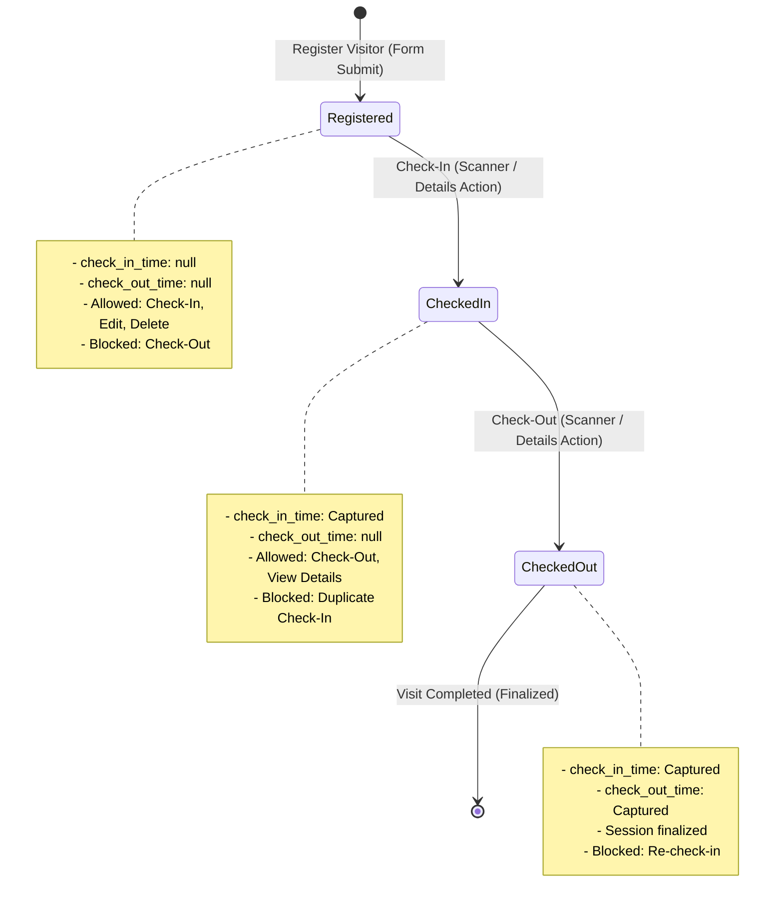

# Architecture & State Management Documentation

**Project**: Visitor Management Mobile Application  
**Architectural Pattern**: MVVM (Model-View-ViewModel) with Clean Separation  
**State Management Engine**: MobX (Transparent Functional Reactive Programming)  
**Dependency Injection**: GetIt (Service Locator)  

---

## 1. Architectural Overview

The application strictly follows the **Model-View-ViewModel (MVVM)** architectural pattern. The codebase separates UI rendering, reactive business logic, and network/data persistence into isolated layers.

```
┌─────────────────────────────────────────────────────────────┐
│                            VIEW                             │
│  - Presentation screens (Dashboard, VisitorList, Form, QR)  │
│  - Reusable visual components (Cards, TextFields, Modals)   │
│  - Bound via Observer widgets; zero business logic          │
└──────────────────────────────┬──────────────────────────────┘
                               │ Observes state & dispatches actions
                               ▼
┌─────────────────────────────────────────────────────────────┐
│                          VIEWMODEL                          │
│  - MobX Stores (VisitorListStore, VisitorRegistrationStore) │
│  - @observable state variables & @computed derived metrics  │
│  - @action methods containing validation & business logic   │
└──────────────────────────────┬──────────────────────────────┘
                               │ Calls repository abstraction
                               ▼
┌─────────────────────────────────────────────────────────────┐
│                            MODEL                            │
│  - Plain Dart Data Models (VisitorListModel, DetailModel)   │
│  - VisitorRepository (Data abstraction layer)               │
│  - Network Layer (DioClient, RestClient, Endpoints)         │
│  - Storage Layer (SharedPreferences, GetStorage cache)      │
└─────────────────────────────────────────────────────────────┘
```

---

## 2. Why MobX Was Chosen for State Management

Candidates were invited to select an appropriate modern state management approach (**Provider / Riverpod / BLoC / MobX**) and explain their decision.

**MobX** was selected based on the following architectural strengths:

### 2.1 Transparent Functional Reactive Programming (TFRP)
- Traditional approaches (like standard `ChangeNotifier` in Provider) trigger whole-widget rebuilds via `notifyListeners()`.
- MobX tracks dependencies automatically at runtime. Only the discrete widgets that read an `@observable` or `@computed` property rebuild when that specific value changes.
- For example, when visitor `#VIS001` transitions from `Registered` to `Checked In`:
  1. Only the status chip on `#VIS001`'s card rebuilds.
  2. The Dashboard `currentlyCheckedIn` card rebuilds.
  3. Other cards in the list do **not** undergo unnecessary widget rebuilds.

### 2.2 Cached & Reactive Computed Values (`@computed`)
- Computed properties automatically derive their values from underlying observables.
- `totalVisitorsToday`, `currentlyCheckedIn`, and `checkedOutToday` are evaluated once and cached until an action mutates the visitor list.
- When a user filters the visitor directory, the filtered subset is computed on-the-fly without maintaining redundant manual state.

### 2.3 Strict Transactional Actions (`@action`)
- State mutations are restricted to `@action` methods.
- MobX wraps action execution in transactions, notifying observers only after all mutations complete, preventing interim flicker or inconsistent states.

### 2.4 Elimination of Boilerplate (Comparison with BLoC)
- In **BLoC**, adding a simple operation (e.g., delete a visitor) requires creating:
  1. `DeleteVisitorEvent`
  2. `VisitorDeletingState`, `VisitorDeletedState`, `VisitorDeleteErrorState`
  3. Event handler with `emit(...)`
  4. `BlocConsumer` / `BlocBuilder` mapping
- In **MobX**, the ViewModel contains a clean, readable async method:
  ```dart
  @action
  Future<bool> deleteVisitor(String id) async {
    await _repository.deleteVisitor(id);
    _allVisitors.removeWhere((v) => v.id == id);
    _applyFilterAndSearch();
    return true;
  }
  ```
  This keeps code concise, auditable, and maintainable.

---

## 3. Dependency Injection with GetIt

All dependencies (network clients, repositories, and ViewModels) are registered as singletons in [lib/di/components/service_locator.dart](file:///lib/di/components/service_locator.dart):

```dart
final getIt = GetIt.instance;

Future<void> setupLocator() async {
  // 1. SharedPreferences & Storage
  final sharedPrefs = await SharedPreferences.getInstance();
  getIt.registerSingleton<SharedPreferenceHelper>(SharedPreferenceHelper(sharedPrefs));

  // 2. Network Client
  getIt.registerSingleton<DioClient>(DioClient(Dio()));

  // 3. API Services
  getIt.registerSingleton<VisitorListApi>(VisitorListApi(getIt<DioClient>()));
  getIt.registerSingleton<VisitorRegistrationApi>(VisitorRegistrationApi(getIt<DioClient>()));

  // 4. Data Repository
  getIt.registerSingleton<Repository>(Repository(
    getIt<SharedPreferenceHelper>(),
    getIt<VisitorListApi>(),
    getIt<VisitorRegistrationApi>(),
  ));

  // 5. ViewModels (MobX Stores)
  getIt.registerSingleton<VisitorListStore>(VisitorListStore(getIt<Repository>()));
  getIt.registerSingleton<VisitorRegistrationStore>(VisitorRegistrationStore(getIt<Repository>()));
  getIt.registerSingleton<ThemeStore>(ThemeStore(getIt<Repository>()));
}
```

Screens inject ViewModels with zero coupling:
```dart
final VisitorListStore _store = getIt<VisitorListStore>();
```

---

## 4. Visitor Lifecycle State Machine

The application enforces a deterministic single-session lifecycle state machine:



---

## 5. UI Error Handling Architecture

The application handles network interruptions, invalid user inputs, and unexpected camera states cleanly:

```
┌────────────────────────┐
│     User Action        │
└───────────┬────────────┘
            ▼
┌────────────────────────┐         Network / Server Error
│     Dio Interceptor    │ ─────────────────────────────────► ┌───────────────────────────┐
└───────────┬────────────┘                                    │    DioErrorUtil Mapper    │
            │ Success (200/201)                               └─────────────┬─────────────┘
            ▼                                                               │ Formats readable error
┌────────────────────────┐                                                  ▼
│   MobX Action Update   │                                    ┌───────────────────────────┐
└───────────┬────────────┘                                    │     ErrorStore Notice     │
            ▼                                                 └─────────────┬─────────────┘
┌────────────────────────┐                                                  ▼
│   Observer UI Rebuild  │                                    ┌───────────────────────────┐
│   (Zero Flicker)       │                                    │ AppToast / Error Dialog   │
└────────────────────────┘                                    └───────────────────────────┘
```

